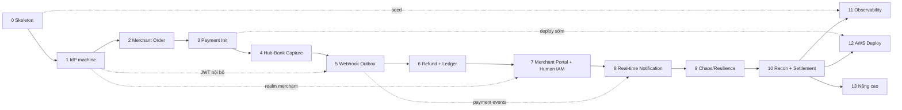

# 06 — Roadmap (Breakdown theo Increment)

> Xương sống của cả dự án. Phân rã theo **lát cắt dọc (vertical slice)**: mỗi Increment
> là một luồng chạy **xuyên các hệ thống**, *demo được ngay*, và mở khóa một cụm kiến thức.
> Đây là tài liệu *sống* — cập nhật khi phạm vi đổi. Chi tiết thiết kế của từng increment
> được đào sâu riêng (khi bắt tay làm increment đó).

---

## 1. Nguyên tắc của roadmap này

1. **Mỗi Increment phải CHẠY ĐƯỢC.** Kết thúc mỗi mốc là một hệ thống demo được đầu-cuối.
2. **Đi từ xương sống ra ngoại vi.** Increment 0–6 = lõi bắt buộc của một gateway. 7–13 =
   làm hệ thống "thật" và bền dần.
3. **Học theo bài toán, không theo công nghệ.** Thêm Kafka *khi* cần giải dual-write.
4. **Sát production ở thiết kế, tối giản ở quy mô** (theo CLAUDE.md).
5. **Mỗi increment gắn với vài Business Flow cụ thể** — flow chi tiết viết ở
   `docs/02-business-flows.md` *đúng lúc làm increment đó*.

## 2. Các biên tin cậy & chiến lược Auth

### 2.1 Auth giữa các service (machine-to-machine) — theo biên tổ chức

**Cross-org thì KHÔNG dùng chung IdP nội bộ.** Mỗi tổ chức chỉ tin auth server của chính nó:

| Biên | Hướng | Bản chất | Cơ chế | Ai cấp credential | Làm ở |
|---|---|---|---|---|---|
| **Merchant server → Hub API** | external vào | cross-org | **API key + HMAC** | Hub cấp cho merchant | Inc 3 |
| **Bank → Hub** (callback) | external vào | cross-org | **callback ký HMAC** | Hub cấp cho bank | Inc 4 |
| **Hub → Bank** | external ra | cross-org | **mTLS** *hoặc* API key/HMAC | **Bank** cấp cho Hub | Inc 4 |
| **Hub-service ↔ Hub-service** | **internal** | cùng org | **OAuth2 client-credentials → JWT** | **IdP realm "internal"** | **IdP (Inc 1)**, dùng thật từ Inc 5+ |

### 2.2 IdP là **Platform IAM có 2 realm** (không nhập nhằng)

Identity Provider (Spring Authorization Server) phục vụ **2 nhóm đối tượng tách khoang** —
đúng mô hình **AWS Cognito** (User Pool cho người ≠ app client cho máy):

| Realm | Đối tượng | Grant | Token đặc điểm | Dùng ở |
|---|---|---|---|---|
| **internal** (machine) | Service nội bộ Hub (`hub-payment`, `hub-ledger`…) | `client_credentials` | `aud`=hub-services, `scope`=`ledger:write`… | Inc 1 |
| **merchant** (human) | Nhân viên của merchant (con người) | `authorization_code` + PKCE (**OIDC login**) | `aud`=merchant-portal, mang `merchantId` (tenant) + `role` | Inc 7 |

- **Nhân viên merchant đăng nhập vào Merchant Portal *phía Hub*** (như Stripe Dashboard).
  **Merchant Demo vẫn KHÔNG login.** API access của *server* merchant vẫn **API key + HMAC**.
- Auth cho **WebSocket** (Inc 8): kênh merchant dùng JWT realm merchant (theo tenant); kênh
  checkout dùng token của payment session (người mua, không login).

## 3. Chiến lược Observability & Deploy

- **Observability:** hạt giống từ Inc 0 (JSON log + health + trace id), đào sâu ở **Inc 11**.
- **Deploy AWS:** walking-skeleton sau **Inc 3**; hoàn thiện IaC ở **Inc 12**. (Muốn tiết
  kiệm thì local-first, dồn deploy vào Inc 12.)

---

## 4. Bản đồ tổng thể (14 Increment)

| # | Increment | Kết quả demo được | Cụm kiến thức mở khóa |
|---|---|---|---|
| **0** | Skeleton & nền tảng | Các service chạy, `/health`, DB migrate | Docker, Spring Boot, Flyway, compose |
| **1** | **Identity Provider (Platform IAM) — realm machine** | Service lấy JWT bằng clientId/secret, gọi nhau có authz | OAuth2 client credentials, JWT, JWKS, scopes |
| **2** | Merchant: catalog → order | Duyệt hàng, giỏ, tạo đơn "chờ thanh toán" | REST/CRUD, JPA, tiền minor-unit |
| **3** | Khởi tạo thanh toán (Merchant→Hub) | Bấm Thanh toán → Hub tạo payment → redirect | API key, HMAC, Idempotency, session |
| **4** | Thu tiền (Hub↔Bank) | Trả tiền ở UI bank → authorize/capture → callback | State machine, timeout/retry/circuit breaker |
| **5** | Báo kết quả (Hub→Merchant webhook) | Đơn merchant tự đổi "đã thanh toán" qua webhook | Outbox, Kafka, at-least-once, DLQ |
| **6** | Refund / Partial refund + Ledger | Hoàn tiền toàn phần/một phần, sổ cái cân | State phức tạp, double-entry, optimistic lock |
| **7** | **Merchant Portal & Human IAM** | Nhân viên merchant login, xem giao dịch, tạo refund, quản lý API key | **OIDC, RBAC, multi-tenant**, self-service API key |
| **8** | **Real-time Notification (WebSocket)** | Payment thành công → Portal + trang checkout hiện noti **live** | **WebSocket, Redis Pub/Sub fan-out, SNS, inbox** |
| **9** | Chaos & Resilience | Bật lỗi (duplicate/timeout/out-of-order) mà hệ vẫn đúng | Idempotency sâu, xử lý lỗi phân tán |
| **10** | Reconciliation + Settlement | Đối soát Hub↔Bank, batch payout cuối ngày | Eventual consistency, batch, S3 file |
| **11** | Observability đầy đủ | Dashboard, trace xuyên hệ thống, alert | OpenTelemetry, Prometheus, Grafana |
| **12** | Deploy AWS | Toàn hệ thống chạy trên AWS qua Terraform | ECS, ALB, RDS, IaC, Secrets |
| **13** | Nâng cao (tùy chọn) | Fraud rule / 3DS-OTP / routing đa bank / API Gateway WS | Event-driven mở rộng, Strategy ở quy mô |

**Phụ thuộc giữa các increment:**

---

## 5. Chi tiết từng Increment

> Khung: **Mục tiêu · Chức năng · Business Flow · Thành phần · Design Pattern · AWS Service
> · Kiến thức · Definition of Done (DoD)**.

### Increment 0 — Skeleton & nền tảng

- **Mục tiêu:** Dựng các service Spring Boot rỗng chạy được cùng lúc trên local, DB riêng,
  nền quan sát tối thiểu. Không nghiệp vụ.
- **Chức năng:** app khởi động; `/health` (actuator); mỗi service kết nối DB riêng; Flyway
  tạo bảng khởi tạo; `docker-compose up` lên cả cụm (app + Postgres + Redis + Kafka).
- **Business Flow:** *(chưa có nghiệp vụ)*.
- **Thành phần:** skeleton `identity-provider`, `merchant`, `payment-hub`, `fake-bank`;
  docker-compose; package chuẩn (api/domain/infra/config); JSON logging.
- **Design Pattern:** Hexagonal skeleton (ports & adapters nhẹ).
- **AWS Service:** *(chưa)* — local; chuẩn bị ECR/Terraform nháp.
- **Kiến thức:** Spring Boot cấu trúc dự án · Docker & compose · Flyway · DB-per-service ·
  JSON logging · Maven multi-module.
- **DoD:** ✅ `docker-compose up` → các `/health` 200 · mỗi service migrate DB riêng · log JSON.

### Increment 1 — Identity Provider (Platform IAM) — realm "machine"

- **Mục tiêu:** Dựng IdP tập trung (kiểu Cognito thu nhỏ). Increment này làm **realm
  "internal" (machine)**: cấp & validate token cho service-to-service qua client credentials.
  *(Realm "merchant" + user login cho con người làm ở Inc 7.)*
- **Chức năng:** đăng ký **client** (mỗi service có `clientId/secret` + **scopes**) ·
  **token endpoint** (`client_credentials` → **JWT** TTL) · **JWKS endpoint** · một
  **resource-server mẫu** bảo vệ theo scope · authorization theo scope trong claim.
- **Business Flow:** *(nền tảng)* — "Service A lấy token bằng clientId/secret → gọi Service B
  kèm Bearer JWT → B validate qua JWKS + check scope".
- **Thành phần:** `identity-provider` (**Spring Authorization Server**) · client store (DB) ·
  auth client lib dùng chung (lấy & cache token) · resource-server config ở service mẫu.
- **Design Pattern:** **Strategy** (grant) · **Chain of Responsibility** (filter chain) ·
  **Adapter/Facade** (client lib) · **Repository**.
- **AWS Service:** *(sau)* Secrets Manager lưu client secret.
- **Kiến thức:** **OAuth2 client credentials** · **JWT** (claims/exp/sign) · **JWKS & key
  rotation** · scopes → authorization · Spring Authorization Server · resource server ·
  token TTL & caching · API-key/HMAC vs OAuth2/JWT.
- **DoD:** ✅ Service lấy JWT bằng clientId/secret · gọi service khác kèm Bearer, validate
  JWKS OK · thiếu scope → 403 · token hết hạn → 401 · test cấp token + validate + scope.

### Increment 2 — Merchant: Catalog → Order

- **Mục tiêu:** Merchant duyệt sản phẩm và tạo Order "chờ thanh toán".
- **Chức năng:** 5–10 sản phẩm (seed) · giỏ hàng · checkout · tạo Order (tính tổng server,
  chốt giá). *(Spec: `docs/specs/01-merchant-spec.md`.)*
- **Business Flow:** tiền-đề *Payment Success* (nhánh tạo đơn).
- **Thành phần:** Merchant BE (Product/Cart/Order + REST) · Merchant FE (React) · Order
  state machine đơn giản.
- **Design Pattern:** Repository · Builder (Order) · State (order status).
- **AWS Service:** *(chưa)*.
- **Kiến thức:** REST API · Spring Data JPA · quan hệ entity · tiền = minor unit + currency ·
  state machine cơ bản · toàn vẹn phía server.
- **DoD:** ✅ Duyệt→giỏ→checkout→tạo Order · tổng đúng (server) · giỏ rỗng không checkout ·
  Order lưu đúng trạng thái đầu · test tính tổng & tạo order.

### Increment 3 — Khởi tạo thanh toán (Merchant → Hub)

- **Mục tiêu:** Merchant gọi Hub tạo payment và điều hướng người mua sang Hub.
- **Chức năng:** đăng ký Merchant + cấp **API key/secret** *(bootstrap: admin/seed tạo; về
  sau merchant tự quản ở Portal — Inc 7)* · Merchant ký request (**HMAC**) · Hub verify chữ
  ký · **Payment Session** (TTL) · **redirect URL** · **Idempotency-Key** · hosted-checkout
  tối giản của Hub.
- **Business Flow:** *Payment Success* (nửa đầu) · *Duplicate Request*.
- **Thành phần:** Hub `payment` service · Hub `gateway`/security (API key, HMAC, idempotency
  filter) · Merchant client · Redis (idempotency store).
- **Design Pattern:** **Chain of Responsibility** (auth→signature→idempotency) · **Strategy**
  (ký) · **Factory** (tạo payment) · Repository.
- **AWS Service:** *(khuyến nghị deploy walking-skeleton sau đây)* — ECR, ECS, ALB, RDS,
  Secrets Manager.
- **Kiến thức:** Spring Security (API key filter) · **HMAC** · **Idempotency** (key+record+TTL) ·
  Redis · payment session & TTL · API contract.
- **DoD:** ✅ Merchant ký request, Hub từ chối chữ ký sai · tạo payment trả redirect URL ·
  2 lần cùng Idempotency-Key chỉ 1 payment · session hết hạn → EXPIRED · test chữ ký & idempotency.

### Increment 4 — Thu tiền (Hub ↔ Bank): authorize & capture

- **Mục tiêu:** Người mua thanh toán ở UI Fake Bank; Hub điều phối authorize→capture, nhận
  kết quả qua callback.
- **Chức năng:** Fake Bank UI (Thành công/Thất bại/Hủy) · Bank API authorize/capture ·
  **callback** về Hub · Hub **State Machine** đầy đủ · gọi bank có **timeout+retry+circuit
  breaker** · *manual review* (treo). **Hub↔Bank là biên CROSS-ORG, KHÔNG dùng IdP nội bộ:**
  Hub xác thực với Bank bằng credential **do Bank cấp** (mTLS *hoặc* API key/HMAC — chốt đầu
  Inc 4); callback Bank→Hub ký HMAC.
- **Business Flow:** *Payment Success* · *Payment Failed* · *User Cancel* · *Timeout* · *Bank Down*.
- **Thành phần:** Fake Bank (BE + UI + tài khoản/balance giả + verify credential Hub gửi) ·
  Hub payment state machine · Hub bank-adapter (WebClient + Resilience4j + đính credential do
  Bank cấp) · callback endpoint (idempotent, verify chữ ký bank).
- **Design Pattern:** **State** (payment) · **Adapter** (bank client) · **Circuit Breaker** ·
  **Template Method** (callback) · **Strategy** (kết quả bank → transition).
- **AWS Service:** *(nếu đã deploy)* dùng lại ECS/ALB/RDS.
- **Kiến thức:** **State machine** chặt · authorize vs capture vs void · **Resilience4j** ·
  callback idempotent · **cross-org auth** (mTLS/HMAC do Bank cấp — khác JWT nội bộ) · async
  (manual review).
- **DoD:** ✅ success/fail/cancel trên UI bank · Hub↔Bank chỉ chấp nhận credential hợp lệ ·
  timeout bank → payment đúng trạng thái, không treo Hub · callback trùng không xử lý 2 lần ·
  transition sai bị chặn · test state machine + integration Hub↔Bank (Testcontainers).

### Increment 5 — Báo kết quả (Hub → Merchant Webhook) + Outbox/Kafka

- **Mục tiêu:** Payment xong → Hub phát event nội bộ & gửi webhook cho merchant *không mất*,
  merchant tự cập nhật đơn.
- **Chức năng:** **Outbox** (ghi trạng thái + event nguyên tử) · publish **Kafka** · worker
  gửi **webhook** ký HMAC · **retry backoff** · **DLQ** · merchant nhận webhook (idempotent)
  đổi Order · return URL.
- **Business Flow:** *Payment Success* (nửa sau) · *Callback Retry* · *Merchant Retry* ·
  *Merchant Down* · *Webhook Retry*.
- **Thành phần:** Hub outbox + poller/CDC · Kafka topic `paymenthub.payment.*` · Hub `webhook`
  worker (SQS + DLQ) · Merchant webhook receiver.
- **Design Pattern:** **Outbox** · **Observer/Pub-Sub** · **Retry** · **Producer/Consumer** ·
  **Template Method** (webhook).
- **AWS Service:** SQS (+ DLQ), SNS (fan-out tùy chọn). *(Kafka self-managed.)*
- **Kiến thức:** **Dual-write & Outbox** · Kafka (topic/partition/consumer group/offset) ·
  **at-least-once + idempotent consumer** · webhook signing & replay · **DLQ** · SQS vs Kafka.
- **DoD:** ✅ Payment success → merchant order tự "đã thanh toán" qua webhook · tắt merchant →
  Hub retry, vào DLQ, không mất event · bật lại → deliver OK · webhook trùng không đổi 2 lần ·
  test outbox + consumer idempotent.

### Increment 6 — Refund / Partial Refund + Ledger

- **Mục tiêu:** Hoàn tiền (toàn phần & một phần nhiều lần) đúng nghiệp vụ, ghi **sổ cái
  double-entry**.
- **Chức năng:** API refund/partial (idempotent) · state machine refund · tổng refund ≤
  captured · **Ledger** bút toán kép · webhook refund.
- **Business Flow:** *Refund* · *Partial Refund* · (chuẩn bị) *Chargeback*.
- **Thành phần:** Hub `refund` (state machine + service) · Hub `ledger` (append-only,
  double-entry) · **optimistic lock** chống refund đua nhau.
- **Design Pattern:** **State** (refund) · **Specification** (điều kiện refund) · **Repository** ·
  **Command** (ledger append-only).
- **AWS Service:** dùng lại; S3 (tùy chọn export ledger).
- **Kiến thức:** state machine phức tạp (1 payment ↔ N refund) · **double-entry accounting** ·
  **optimistic vs pessimistic lock** · invariant tiền · idempotency refund.
- **DoD:** ✅ Refund toàn phần & nhiều lần một phần đúng · không vượt captured · 2 refund đồng
  thời không phá số dư (lock) · ledger luôn cân (Σdebit=Σcredit) · webhook refund · test ràng
  buộc & concurrency.

### Increment 7 — Merchant Portal & Human IAM (OIDC + RBAC + multi-tenant)

- **Mục tiêu:** Cung cấp **Merchant Portal phía Hub** (như Stripe Dashboard) cho *con người*
  của merchant đăng nhập; mở **realm "merchant"** trong IdP với **RBAC + multi-tenant**.
- **Chức năng:** **OIDC login** (`authorization_code` + PKCE) · **MFA bằng TOTP** (enrollment
  QR + secret, challenge mã 6 số khi login, **recovery codes**) · **access token TTL ngắn +
  refresh token dài hạn** · **Logout** (xóa session Portal + **revoke refresh token** RFC 7009
  + tùy chọn `end_session_endpoint`) · **refresh token rotation + reuse detection** · realm
  "merchant": user thuộc **tenant = merchant**, có **role** (`owner`/`admin`/`refund`/`viewer`) ·
  token mang `merchantId` + `role` · Portal UI (BFF: token giữ ở server, cookie httpOnly): xem
  giao dịch **chỉ của tenant mình**, chi tiết payment, **tạo refund**, **tạo/thu hồi API key** ·
  Hub enforce **tenant isolation** + **RBAC**.
- **Business Flow:** *(quản trị)* — quản lý giao dịch/refund/API key theo tenant.
- **Thành phần:** `payment-hub` merchant-portal (BE + React) · IdP realm "merchant" (OIDC) ·
  RBAC enforcement · API-key management service · tenant filter ở query.
- **Design Pattern:** **RBAC/Policy** · **Specification** (lọc tenant) · **Strategy** (grant
  OIDC) · **Facade** (portal BFF) · **Interceptor** (tenant context).
- **AWS Service:** Secrets Manager; *(so sánh khái niệm với Cognito User Pool)*.
- **Kiến thức:** **OIDC / authorization_code + PKCE** · **MFA / TOTP** (RFC 6238) +
  multi-step authentication · human vs machine auth · **RBAC** ·
  **multi-tenancy & tenant isolation** · session vs JWT cho web · **BFF pattern** · **token
  revocation** (RFC 7009) · **refresh token rotation & reuse detection** · RP-initiated logout ·
  *tại sao JWT access token không thu hồi tức thì được* (TTL ngắn vs denylist) · **API key
  lifecycle** · realm/user-pool.
- **DoD:** ✅ Nhân viên login vào Portal (authorization_code + PKCE) · chỉ thấy dữ liệu merchant
  mình (thử tài khoản khác → không thấy) · role `refund` tạo được refund, `viewer` → **403** ·
  **login bắt buộc nhập MFA code đúng mới cấp token; enroll MFA qua QR; recovery code dùng
  được** · **logout → refresh token bị revoke, không lấy được access token mới; refresh token
  cũ tái dùng bị chặn** · tạo/thu hồi API key OK · test RBAC + tenant isolation + MFA + revoke.

### Increment 8 — Real-time Notification (WebSocket + fan-out) ⭐ MỚI

- **Mục tiêu:** Đẩy **thông báo real-time** khi có sự kiện (payment thành công/thất bại/refund)
  tới (a) nhân viên merchant đang mở Portal, (b) người mua ở trang checkout/return — qua
  **WebSocket**; kèm fan-out đa kênh và "hộp thư" bền vững.
- **Phân chia kênh (đã chốt):** **Real-time vào trình duyệt = WebSocket** (Spring STOMP +
  Redis Pub/Sub, self-managed). **Email = AWS SES/SNS.** Inbox = DB. *(Mobile push / Web
  Push khi tab đóng = SNS/Pinpoint/Web-Push — để Inc 13 nếu cần.)*
- **Chức năng:** `hub-notification` **consume Kafka** payment events · 2 kênh WebSocket:
  **`/ws/merchant`** (auth **JWT realm merchant**, lọc theo **tenant**) + **`/ws/checkout/{sessionId}`**
  (auth = **token payment session**, người mua không login) · **fan-out giữa instance qua
  Redis Pub/Sub** · **notification store** (inbox) để xem lại khi offline · **SNS** fan-out
  email (tùy chọn).
- **Business Flow:** real-time push khi *Payment Success/Failed/Refund*; tenant-scoped.
- **Thành phần:** `hub-notification` (Spring WebSocket/STOMP) · **Redis Pub/Sub** (fan-out
  cross-instance) · notification store (DB) · Kafka consumer · SNS (email) · **ALB** (WS
  upgrade) · WS auth (JWKS cho merchant, session token cho checkout).
- **Design Pattern:** **Observer/Pub-Sub** · **Mediator** (broadcast) · **Adapter** (kênh
  push) · **Strategy** (kênh: WS/email/inbox).
- **AWS Service:** **ALB** (WebSocket) · **SNS** (fan-out email) · **ElastiCache Redis**
  (pub/sub). *(Phiên bản managed thay thế: **API Gateway WebSocket + Lambda + DynamoDB** — ghi
  là upgrade path, làm ở Inc 13 nếu muốn.)*
- **Kiến thức:** **WebSocket** real-time push · **distributed connection state** (Redis pub/sub
  fan-out giữa instance) · **WS authentication** · **tenant routing** · best-effort + durable
  inbox · **SNS fan-out** · self-managed WS vs API Gateway WebSocket.
- **DoD:** ✅ Payment success → Portal của **đúng merchant** hiện noti live (merchant khác
  không thấy — tenant isolation) · trang checkout tự cập nhật "thành công" **không polling** ·
  user offline → mở lại thấy trong inbox · **scale 2 instance notification → push vẫn tới đúng
  connection** (qua Redis) · WS từ chối token sai · test consumer + routing.

### Increment 9 — Chaos & Resilience hardening

- **Mục tiêu:** Chứng minh hệ đứng vững trước lỗi phân tán bằng cách *chủ động* bơm lỗi.
- **Chức năng:** Chaos engine ở Fake Bank (delay/timeout/500/duplicate/out-of-order/
  insufficient/random) & Merchant (webhook 500/timeout/slow/down) · Hub xử lý đúng mọi ca ·
  **out-of-order callback** · **callback tới sau khi đã EXPIRED**.
- **Business Flow:** *Duplicate* · *Callback out-of-order* · *Bank Down* · *Merchant Down* ·
  *Timeout* · *Payment Hub Restart*.
- **Thành phần:** Chaos toggles · Hub reconcilable state handling · replay sau restart
  (outbox/inbox) · distributed lock (Redisson).
- **Design Pattern:** **Idempotent Receiver** · **Distributed Lock** · **Saga** (đền bù) ·
  **Retry/Backoff**.
- **AWS Service:** dùng lại; CloudWatch.
- **Kiến thức:** **idempotency chuyên sâu** · out-of-order & late message · **distributed
  lock** · **exactly-once (thực dụng)** · khôi phục sau restart · chaos engineering.
- **DoD:** ✅ Mỗi chế độ chaos → payment hội tụ đúng, tiền không lệch · restart Hub giữa chừng →
  không mất/không double · duplicate & out-of-order xử lý đúng · test tích hợp từng chế độ.

### Increment 10 — Reconciliation + Settlement

- **Mục tiêu:** Phát hiện & chữa lệch Hub↔Bank; gom giao dịch trả tiền cho merchant.
- **Chức năng:** Bank sinh **file đối soát** cuối ngày (S3) · Hub **reconciliation** so khớp,
  đánh dấu lệch, tạo điều chỉnh · **Settlement** batch: gom captured, trừ phí, tạo **payout** ·
  report.
- **Business Flow:** *Reconciliation* · *Settlement*.
- **Thành phần:** Hub `reconciliation` (scheduler + matcher) · Hub `settlement` (batch +
  payout) · S3 file · Kafka recon stream · ledger cập nhật.
- **Design Pattern:** **Batch/Scheduler** · **Strategy** (quy tắc khớp) · **Template Method**
  (pipeline) · **Saga** (điều chỉnh lệch).
- **AWS Service:** **S3** · **Lambda** (xử lý file S3 – tùy chọn) · EventBridge/Scheduler ·
  CloudWatch.
- **Kiến thức:** **eventual consistency & reconciliation** · batch · settlement & phí ·
  **T+1 payout** · file-based integration · ledger cho settlement.
- **DoD:** ✅ Tạo lệch cố ý → reconciliation phát hiện & chữa · settlement tạo payout đúng số
  (captured − refund − phí) · report khớp ledger · test matcher các ca lệch.

### Increment 11 — Observability đầy đủ

- **Mục tiêu:** Nhìn thấy & cảnh báo toàn hệ thống; trace một payment xuyên các hệ thống.
- **Chức năng:** Metrics (Micrometer→Prometheus) · dashboard Grafana · **distributed tracing**
  (OpenTelemetry→Jaeger/Tempo) truyền trace merchant→Hub→bank→webhook · **alert** (rule →
  SNS/email) · log tập trung.
- **Business Flow:** *(cắt ngang mọi flow)*.
- **Thành phần:** OTel SDK ở các service · Prometheus + Grafana · Jaeger/Tempo · alert rules.
- **Design Pattern:** **Decorator/Interceptor** (instrument) · **Observer** (alert).
- **AWS Service:** CloudWatch (log/metric/alarm) · SNS (alert) · (tùy chọn AMP/AMG).
- **Kiến thức:** **OpenTelemetry** · Prometheus + Micrometer · Grafana · **trace context
  propagation** · RED/USE metrics · alerting.
- **DoD:** ✅ Dashboard success/latency/lỗi · trace một payment thấy đủ các hệ thống · alert
  khi lỗi vượt ngưỡng · log tương quan theo trace id.

### Increment 12 — Deploy AWS (hoàn thiện IaC)

- **Mục tiêu:** Toàn hệ thống chạy trên AWS, dựng/tắt bằng Terraform.
- **Chức năng:** VPC (public/private, SG, VPC endpoints) · ECS Fargate các nhóm service · ALB
  host/path routing (kèm WebSocket) · RDS · ElastiCache · Kafka trên Fargate · Secrets Manager ·
  CI/CD.
- **Business Flow:** *(vận hành mọi flow trên cloud)*.
- **Thành phần:** Terraform modules (vpc/ecs/rds/redis/kafka/alb/iam) · pipeline CI/CD ·
  LocalStack cho dev.
- **Design Pattern:** **IaC module** · **Immutable deployment**.
- **AWS Service:** ECS, ALB, RDS, ElastiCache, S3, SQS/SNS, Secrets Manager, IAM, VPC,
  CloudWatch, ECR. *(EKS/MSK = upgrade path.)*
- **Kiến thức:** **Terraform/IaC** · ECS Fargate · VPC/SG · **least-privilege IAM per service** ·
  secrets · CI/CD · tránh NAT bằng VPC endpoints · ephemeral env.
- **DoD:** ✅ `terraform apply/destroy` sạch · service chạy sau ALB · secrets không hardcode ·
  pipeline auto-deploy · chi phí kiểm soát được.

### Increment 13 — Nâng cao (tùy chọn)

- **Mục tiêu:** Đào sâu một chủ đề gateway thật khi lõi đã vững.
- **Lựa chọn:** Fraud Detection (rule engine, Kafka consumer) · 3DS/OTP challenge · Payment
  Routing (≥2 fake bank, Strategy quy mô) · Chargeback/Dispute (saga đảo tiền) · **MFA nâng
  cao** (WebAuthn/passkey, SMS-OTP qua SNS — bổ sung cho TOTP ở Inc 7) · **API Gateway
  WebSocket** (bản managed của Inc 8 — DynamoDB + Lambda).
- **Design Pattern:** **Strategy/Router** · **Rules/Specification** · **Saga** · **Adapter**.
- **AWS Service:** dùng lại; Kafka consumer mở rộng; (WS managed) API Gateway WS + Lambda +
  DynamoDB.
- **Kiến thức:** event-driven mở rộng · rule engine · multi-provider · long-running saga · MFA ·
  serverless WebSocket.
- **DoD:** tùy tính năng — luôn kèm test & demo được.

---

## 6. Ma trận Business Flow → Increment

| Business Flow | Increment |
|---|---|
| Service-to-service auth (nền tảng) | 1 |
| Payment Success | 3 → 4 → 5 |
| Payment Failed / User Cancel | 4 |
| Timeout | 4 (bank) · 3 (session) |
| Duplicate Request | 3 · 9 (sâu) |
| Merchant Retry / Merchant Down | 5 |
| Callback Retry / out-of-order | 5 · 9 |
| Refund / Partial Refund | 6 |
| Merchant self-service (login, quản lý refund/API key) | 7 |
| Real-time notify (payment success → Portal/checkout) | 8 |
| Bank Down | 4 · 9 |
| Payment Hub Restart | 9 |
| Reconciliation / Settlement | 10 |

---

## 7. Các hệ thống / service

| Service | Loại | Thư mục |
|---|---|---|
| Identity Provider (**Platform IAM**: realm machine + realm merchant) | Platform | `identity-provider/` |
| Merchant Demo (không login) | Business | `merchant-demo/` |
| Payment Hub (chính; gồm nhiều service con: payment, webhook, ledger, refund, reconciliation, **notification**, + **Merchant Portal**) | Business | `payment-hub/` |
| Fake Bank | Business (giả lập) | `fake-bank/` |

> **Merchant Portal** & **hub-notification** nằm phía Payment Hub. Merchant Demo vẫn tối giản.

---

## 8. Cách dùng roadmap với chế độ problem-first

Với **mỗi Increment**: (1) BA ra spec nghiệp vụ → (2) engineer thiết kế (state machine, data
model, API, pattern) → (3) review → (4) code + test tới DoD → (5) chốt DoD, cập nhật CLAUDE.md
Mục 7 → increment kế.

> Bắt đầu từ **Increment 0**. Khi bạn sẵn sàng, mình ra spec/đề cho Increment 0.
